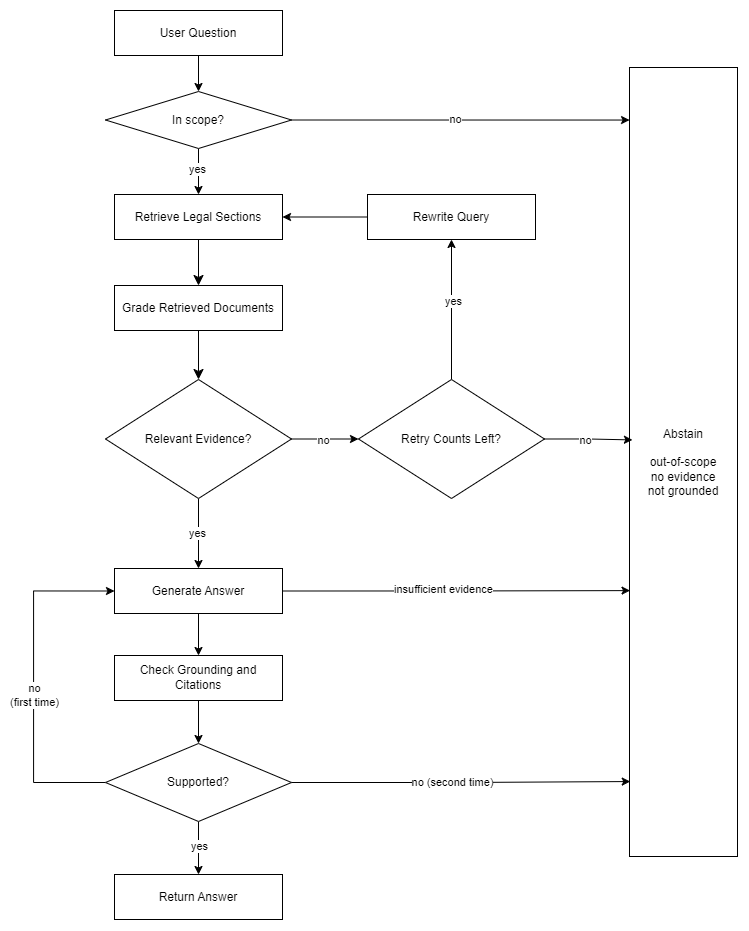

# Corrective Agentic RAG System for Malaysian Employment Law (`employ-law-agent`)

An end-to-end **Corrective Retrieval-Augmented Generation (RAG) Agent** built with **LangGraph** and **ChromaDB** to answer statutory questions grounded strictly in Malaysia's **Employment Act 1955 (Act 265, Reprint as at 1 August 2023)**[cite: 3, 4].

Unlike a linear RAG chain that blindly answers every prompt, this system operates as a stateful graph that validates jurisdictional scope, grades retrieved statutory sections, rewrites weak queries, verifies factual grounding against source text, and safely abstains when evidence is insufficient[cite: 2, 6].

---

## Architecture

[cite: 1]

### Agentic Control Flow (`LangGraph`)

```text
START
  │
  ▼
check_scope ──(sabah_sarawak / out_of_scope)──► abstain ──► END
  │ (in_scope)
  ▼
retrieve (ChromaDB top-5) ◄──┐
  │                          │
  ▼                          │ (0 relevant & rewrites < 1)
grade_documents ─────────────┴─► rewrite_query
  │
  ├─(0 relevant & max rewrites)──► abstain ──► END
  │ (relevant sections kept)
  ▼
generate (with [s.XX] citations) ──(INSUFFICIENT_EVIDENCE)──► abstain ──► END
  │
  ▼
check_grounding ──(unsupported & regens < 1, with feedback)──► generate
  │
  ├─(unsupported & max regens)──► abstain ──► END
  │ (supported)
  ▼
 END
```

### Key Engineering Decisions

* **TOC-Guided Statutory Parsing (`ingest.py`):** Parses raw PDF pages by stripping running headers, footers, and footnotes, then uses the *Arrangement of Sections* to segment the body into clean statutory sections without splitting on numbered sub-clauses[cite: 3].
* **Structure-Aware Chunking (`vectorstore.py`):** Preserves semantic integrity by keeping **1 section = 1 chunk** for standard sections and splitting only sections exceeding 3,000 characters along subsection boundaries (`\n`), prepending the section number and title to every chunk[cite: 4].
* **Domain-Specific Jurisdictional Guardrails (`check_scope`):** Explicitly distinguishes queries governed by the **Employment Act 1955** (Peninsular Malaysia and Labuan) from queries about **Sabah and Sarawak** (which fall under separate Labour Ordinances) or out-of-scope topics (e.g., tax, immigration)[cite: 2, 6].
* **Multi-Model Separation of Concerns:** Uses separate LLMs across roles so no single model grades its own output[cite: 2, 6]:
  * **Generator:** `gpt-5-nano`[cite: 2, 6]
  * **Router / Grader / Grounding Checker:** `google/gemini-2.5-flash-lite`[cite: 2, 6]
  * **Evaluation Judge:** `anthropic/claude-haiku-4.5`[cite: 2, 6]

---

## Setup & Usage

This project uses [`uv`](https://docs.astral.sh/uv/) for dependency and environment management.

### 1. Install Dependencies

```bash
uv sync
```

### 2. Configure Environment Variables

Create a `.env` file in the project root with your OpenRouter API key:

```env
OPENROUTER_API_KEY=your_openrouter_api_key_here
```

### 3. Run the Pipeline

```bash
# 1. Extract structured sections from the Employment Act PDF -> data/sections.json
uv run ingest-act

# 2. Chunk sections and build the persisted ChromaDB index -> chroma_db/
uv run build-vectorstore

# 3. Query the agent from the CLI
uv run employ-law-agent "What is the maximum normal working week?"

# 4. Run the 23-question benchmark comparing Baseline RAG vs. Agentic RAG
uv run eval-agent
```

---

## Evaluation & Error Analysis

Both the **Baseline RAG** (`retrieve -> generate`) and the **Corrective Agent** were evaluated on a 23-question benchmark (`eval/questions.csv`) spanning direct lookups, multi-section synthesis, scenario questions, ambiguous prompts, and out-of-scope queries[cite: 2, 6]:

| System | Retrieval Hit | Citation Valid | Faithful (Judge) | Behaviour / Abstention OK | Avg Latency (s) |
| :--- | :---: | :---: | :---: | :---: | :---: |
| **Baseline RAG** | *X/16* | *X/16* | *X/23* | *X/23* | *XX.X* |
| **Agentic RAG** | *X/16* | *X/16* | *X/23* | *X/23* | *XX.X* |

*(Replace the `X` placeholders above with the final table printed by `uv run eval-agent`.)*

### Key Takeaways from Failure Analysis

* **Out-of-Scope & Jurisdictional Safety:** Baseline RAG attempts to answer questions about Sabah workers or income tax using loosely related text, whereas `check_scope` intercepts and abstains immediately (~0.8s latency)[cite: 2, 5, 6].
* **Latency vs. Reliability Trade-off:** Multi-step grading and grounding verification add latency on complex queries, making it best suited for high-precision compliance and HR guidance workflows rather than sub-second autocomplete[cite: 2, 6].
* **Schedule-Dependent Coverage:** Questions about employee eligibility (e.g., overtime applicability under the First Schedule) highlight the importance of indexing statutory schedules alongside substantive sections[cite: 2, 3, 6].

---

## Disclaimer

This software provides general legal information derived from the text of the Malaysian Employment Act 1955 for educational and portfolio purposes only[cite: 2, 5, 6]. It does not constitute formal legal advice; consult the Department of Labour Peninsular Malaysia (JTKSM) or a qualified legal practitioner for specific employment matters[cite: 2, 6].
